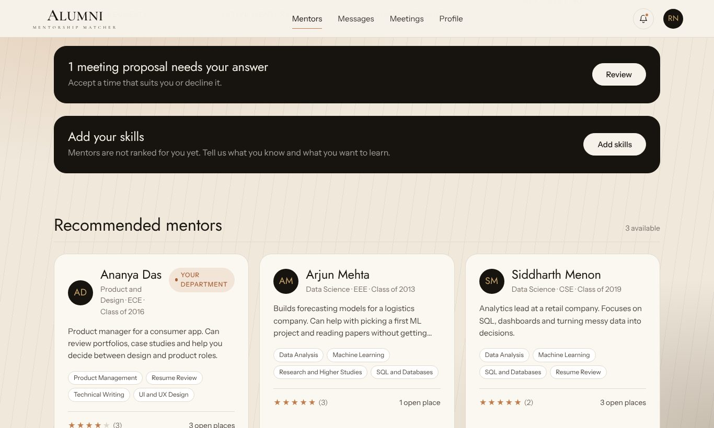
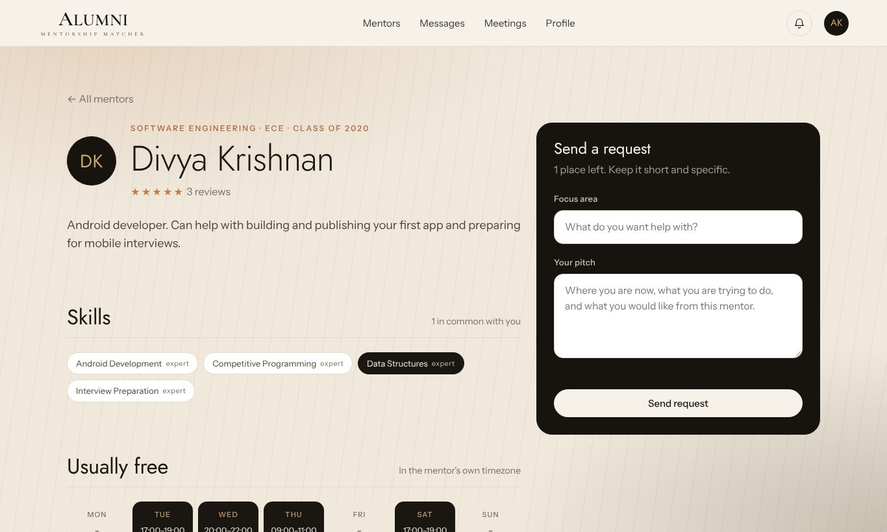
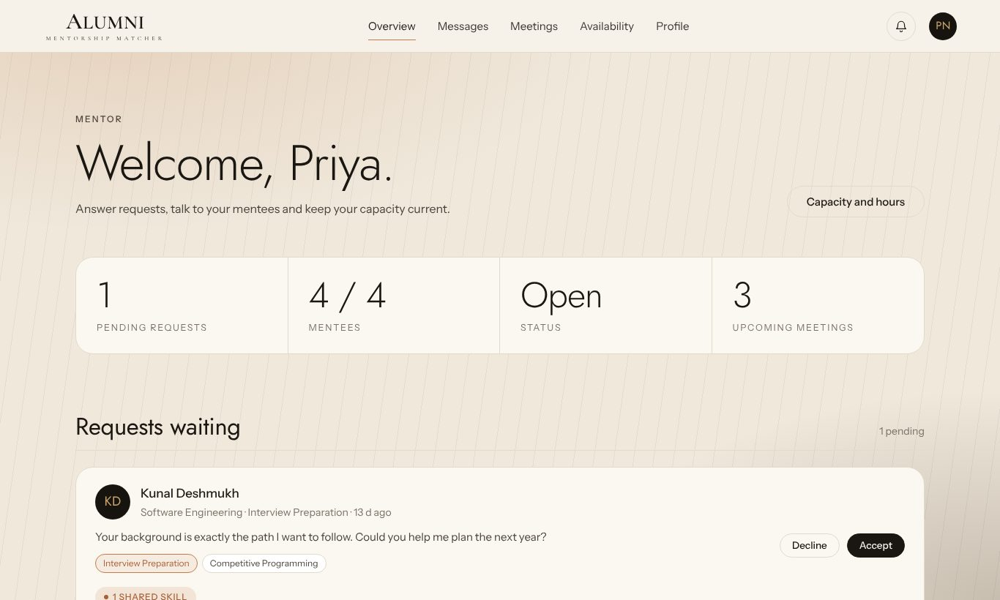
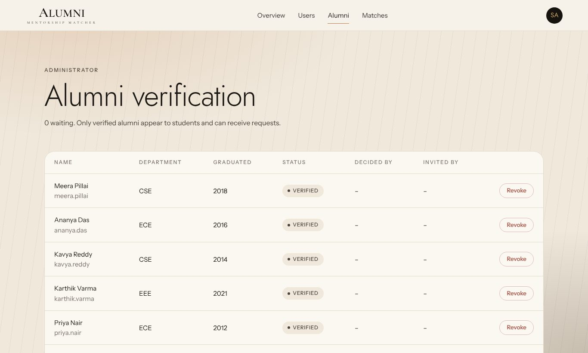
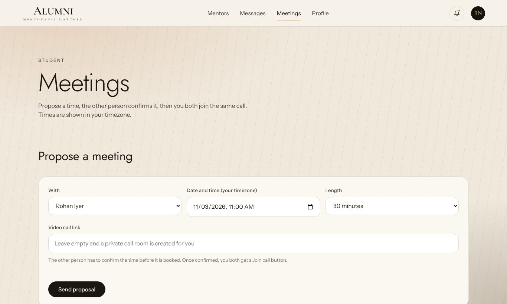
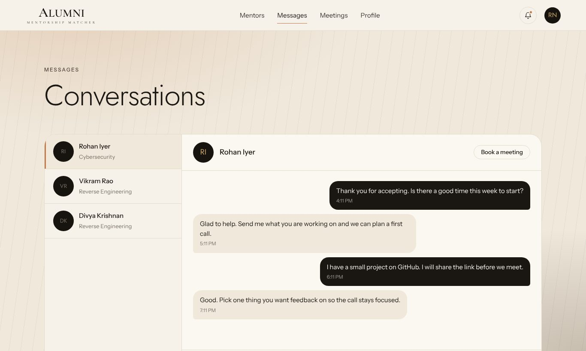
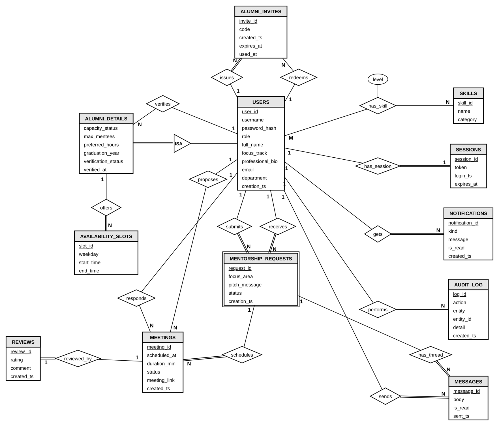

# Alumni Mentorship Matcher

A web app that connects students with alumni mentors. Students find mentors ranked by shared skills, send a request, chat once it is accepted, agree on a meeting time and rate the meeting afterwards. Mentors control how many people they take on, and administrators verify alumni and watch the numbers.

The interesting part is where the rules live. Roles, mentor capacity, duplicate requests, overlapping meetings and review conditions are enforced **inside MySQL** with triggers, stored procedures and constraints, so no client can bypass them. The Node API is a thin layer on top.

**Live demo:** https://harinandhreddy0411.github.io/alumni-mentorship-matcher/ (the API runs on a free tier and can take up to a minute to wake up)


## Features

**Students**
- Mentors ranked by shared skills, then same department, then rating
- Send a request with a focus area and a pitch, withdraw it while it is pending
- Private chat with unread counts after a request is accepted
- Propose meeting times, join a call link, rate completed meetings

**Alumni**
- Set status (active or paused), maximum mentees (1 to 20), weekly availability and preferred hours
- See each request with the student's pitch and skills, accept or decline
- Invite other alumni with one-time codes (up to 3 unused at a time)
- Hidden from students until verified

**Administrators**
- Verify, reject or revoke alumni; create invite codes that verify new alumni at once
- Manage users and matches, read the audit log
- Analytics from views, a CTE and window functions: requests per month, acceptance rate, skills in demand, top mentors per track, mentors with no requests

**Everyone**
- Notifications raised by triggers, shown in the viewer's own time zone
- Meetings always have a call link: the one given, or a generated Jitsi Meet room

| Student dashboard | Mentor page |
|---|---|
|  |  |
| **Alumni dashboard** | **Admin: alumni verification** |
|  |  |
| **Meetings** | **Chat** |
|  |  |

## Tech stack

| Layer | Technology |
|---|---|
| Frontend | HTML, CSS, vanilla JavaScript, canvas artwork, no build step |
| API | Node.js, Express, mysql2, bcryptjs |
| Database | MySQL 8 |
| Hosting | GitHub Pages (frontend), Render (API), Aiven (MySQL) |

## How it is built

```
Browser (static pages)  ->  Express API (stateless)  ->  MySQL 8
GitHub Pages                Render                        Aiven
```

Passwords are bcrypt hashes. A login creates a row in `sessions`; every API call checks the token and role. All SQL uses placeholders. The API pool runs in UTC and the browser converts times.

### Database

Thirteen tables, normalized to BCNF. The full description is in [docs/DATABASE.md](docs/DATABASE.md).



| Table | Holds |
|---|---|
| users | Every account: student, alumni or admin, with department |
| alumni_details | Mentor capacity and verification (subtype of users) |
| availability_slots | Weekly time slots a mentor offers |
| skills, user_skills | Skill catalogue and the many-to-many link with a level |
| mentorship_requests | A student's request to a mentor and its status |
| messages | Chat inside an accepted match |
| meetings | Proposed, scheduled, completed, cancelled or declined meetings |
| reviews | One rating per completed meeting |
| notifications | Alerts raised by triggers |
| audit_log | Who changed what, written by triggers |
| sessions | Login tokens with an expiry |
| alumni_invites | One-time invite codes |

### Rules enforced inside MySQL

| Rule | How |
|---|---|
| Only students send requests, only to verified, active alumni | BEFORE INSERT trigger on mentorship_requests |
| One open request per student and mentor | Same trigger |
| A mentor cannot accept past the maximum | BEFORE UPDATE trigger, run inside sp_respond_request with a row lock |
| Closed requests stay closed; only pending ones can be withdrawn | BEFORE UPDATE trigger, sp_withdraw_request |
| Only accepted matches can chat | BEFORE INSERT trigger on messages |
| Meetings: future time, no overlap for either person, other person must accept | Triggers and sp_book_meeting, sp_set_meeting_status |
| Reviews only for completed meetings, once, by the mentee | Trigger, UNIQUE, sp_submit_review |
| Only an admin changes alumni verification | trg_alumni_bu, sp_verify_alumnus |
| Invite codes are single use and expire after 14 days | sp_create_invite, sp_redeem_invite |
| Admin accounts cannot be deleted | BEFORE DELETE trigger |
| Ratings 1 to 5, durations 15 to 180 minutes, mentees 1 to 20 | CHECK constraints |

Also in the database: 5 views, 1 function (`fn_match_score`), 11 procedures and 14 triggers. The mentor ranking uses `RANK() OVER`, and the admin leaderboard uses a CTE with `RANK() OVER (PARTITION BY focus_track ...)`.

Migrations are numbered files in `backend/db/sql`. `npm run migrate` applies each once, records it in `schema_migrations`, and re-applies `R__logic.sql` (views, function, procedures, triggers).

## API

All routes are under `/api`. Everything except the public routes needs the `x-session-token` header.

| Area | Routes |
|---|---|
| Auth | `POST /auth/register`, `POST /auth/login`, `POST /auth/logout`, `GET /auth/me` |
| Mentors | `GET /mentors`, `GET /mentors/:id` |
| Requests | `POST /requests`, `GET /requests/mine`, `GET /requests/incoming`, `GET /requests/mentees`, `PATCH /requests/:id`, `POST /requests/:id/withdraw`, `GET /matches/mine` |
| Profile | `GET` and `PUT /profile`, `GET` and `POST /skills`, `PUT /profile/skills`, `GET` and `PUT /capacity` |
| Chat and alerts | `GET` and `POST /messages/:requestId`, `GET /notifications`, `POST /notifications/read` |
| Meetings | `GET` and `POST /meetings`, `PATCH /meetings/:id`, `POST /meetings/:id/review` |
| Invites | `GET` and `POST /invites` |
| Public | `GET /public/summary`, `GET /health`, `GET /health/db` |
| Admin | `GET /admin/stats`, `GET /admin/analytics`, `GET /admin/audit`, users CRUD under `/admin/users`, `GET` and `PATCH /admin/matches`, `GET` and `PATCH /admin/alumni` |

## Run it locally

Requires Node.js 18+ and MySQL 8.

```
git clone https://github.com/harinandhreddy0411/alumni-mentorship-matcher.git
cd alumni-mentorship-matcher/backend
npm install
cp .env.example .env
```

Edit `backend/.env` with your database details, then create the database and start:

```
mysql -u root -p -e "CREATE DATABASE alumni_matcher"
npm run migrate
npm run seed
npm run seed:demo
npm start
```

In another terminal, serve the frontend from the project root:

```
python3 -m http.server 5500
```

Open http://localhost:5500. On localhost the frontend calls `http://localhost:3000/api`.

`seed` creates the admin account (`admin`, with `ADMIN_PASSWORD` from `.env`, or `adminpassword` if unset). `seed:demo` adds 10 mentors, 24 students, requests, meetings, reviews and chat history. Demo accounts use the password `password123`, for example `priya.nair` (alumnus) or `rahul.nambiar` (student). Change the admin password before putting anything online.

## Tests

```
npm run test:db
npm run test:api
```

`test:db` runs 67 checks straight against the database: every trigger, procedure and constraint. `test:api` runs 79 checks over HTTP and needs the server running. Both create their own users and remove them at the end. They were run on MariaDB 10.11. After setting up MySQL 8, run `test:db` once against it.

## Deploying

See [docs/DEPLOYMENT.md](docs/DEPLOYMENT.md) for the GitHub Pages, Render and Aiven setup.

## Known limits

- Anyone can register as a student. Alumni are checked by an administrator or an invite code, but there is no automatic proof of graduation.
- Chat is polled, not pushed, and there is no email, so notifications appear only inside the app.
- Video calls use a link (Jitsi Meet by default); the app does not host them.
- Free hosting tiers sleep when idle.
- Revoking an alumnus hides them from new requests but does not end matches that are already accepted.

## Credits

Fonts: Jost, Instrument Sans and Cormorant Garamond, self-hosted under the SIL Open Font License.

## Author

HarinandhReddy A ([harinandhreddy@gmail.com](mailto:harinandhreddy@gmail.com), [GitHub](https://github.com/harinandhreddy0411))

## License

MIT. See [LICENSE](LICENSE).
