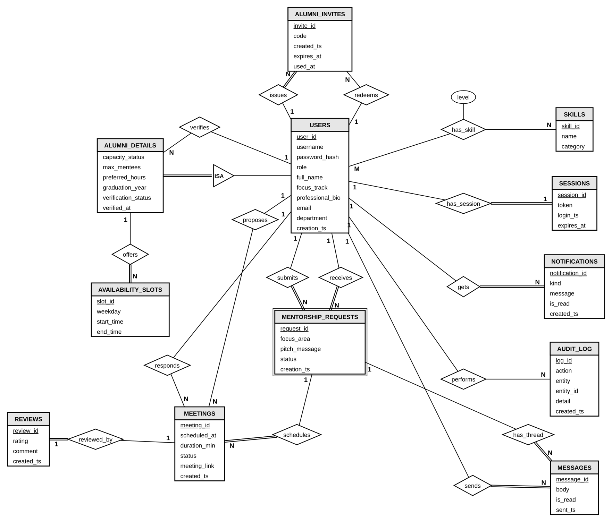

# Database

MySQL 8, thirteen tables plus a `schema_migrations` bookkeeping table that records which SQL files have been applied. All tables are in BCNF.



Rectangles are entities, diamonds are relationships, a double line is total participation, and 1, N and M are cardinalities. Foreign key columns are not repeated inside the entity boxes because the relationship diamonds already show them. `MENTORSHIP_REQUESTS` is drawn with a double border because it is an associative entity between a student and an alumnus.

## Relationships

| Relationship | Between | Cardinality | Participation |
|---|---|---|---|
| ISA | users and alumni_details | 1 to 1 | alumni_details is always a user; a user is not always an alumnus |
| offers | alumni_details and availability_slots | 1 to N | a slot always belongs to a mentor |
| has_skill | users and skills | M to N, with `level` on the link | both partial |
| has_session | users and sessions | 1 to 1 | a session always has a user |
| gets | users and notifications | 1 to N | a notification always has a user |
| performs | users and audit_log | 1 to N | `actor_id` is nullable, so partial |
| submits | users and mentorship_requests | 1 to N | a request always has a student |
| receives | users and mentorship_requests | 1 to N | a request always has an alumnus |
| schedules | mentorship_requests and meetings | 1 to N | a meeting always belongs to a request |
| has_thread | mentorship_requests and messages | 1 to N | a message always belongs to a request |
| sends | users and messages | 1 to N | a message always has a sender |
| proposes | users and meetings | 1 to N | `proposed_by` is nullable, so partial |
| responds | users and meetings | 1 to N | `acted_by` is nullable, so partial |
| reviewed_by | meetings and reviews | 1 to 1 | a review always belongs to a meeting |
| verifies | users (admin) and alumni_details | 1 to N | `verified_by` is nullable, so partial |
| issues | users and alumni_invites | 1 to N | an invite always has an issuer |
| redeems | users and alumni_invites | 1 to N | `used_by` is nullable, so partial |

Two points that are easy to get wrong:

- `(student_id, alumni_id)` is **not** a key of `mentorship_requests`. A student can ask the same mentor again after a decline or a withdrawal. "One open request per pair" is enforced by a trigger instead.
- Only alumni get an `alumni_details` row. That is enforced by the application (registration and the admin user screens), not by the schema.

## Tables

### users

| Column | Type | Null | Key | Notes |
|---|---|---|---|---|
| user_id | int(11) | no | PK | auto increment |
| username | varchar(50) | no |  |  |
| password_hash | varchar(255) | no |  |  |
| role | enum('student','alumni','admin') | no |  |  |
| full_name | varchar(100) | no |  |  |
| focus_track | varchar(30) | yes |  |  |
| professional_bio | text | yes |  |  |
| email | varchar(120) | yes |  |  |
| creation_ts | datetime | no |  | default current_timestamp() |
| department | varchar(60) | yes |  |  |

UNIQUE (username)

### alumni_details

| Column | Type | Null | Key | Notes |
|---|---|---|---|---|
| alumni_id | int(11) | no | PK FK | references users(user_id), ON DELETE CASCADE |
| capacity_status | enum('active','paused') | no |  | default 'active' |
| max_mentees | int(11) | no |  | default 3 |
| preferred_hours | varchar(100) | yes |  |  |
| verification_status | enum('pending','verified','rejected') | no |  | default 'pending' |
| graduation_year | smallint(6) | yes |  |  |
| verified_by | int(11) | yes | FK | references users(user_id), ON DELETE SET NULL |
| verified_at | datetime | yes |  |  |

CHECK `max_mentees` between 1 and 20  
CHECK `graduation_year` is null or `graduation_year` between 1990 and 2100

### availability_slots

| Column | Type | Null | Key | Notes |
|---|---|---|---|---|
| slot_id | int(11) | no | PK | auto increment |
| alumni_id | int(11) | no | FK | references alumni_details(alumni_id), ON DELETE CASCADE |
| weekday | tinyint(4) | no |  |  |
| start_time | time | no |  |  |
| end_time | time | no |  |  |

UNIQUE (alumni_id,weekday,start_time)  
CHECK `weekday` between 0 and 6  
CHECK `end_time` > `start_time`

### skills

| Column | Type | Null | Key | Notes |
|---|---|---|---|---|
| skill_id | int(11) | no | PK | auto increment |
| name | varchar(40) | no |  |  |
| category | varchar(30) | no |  |  |

UNIQUE (name)

### user_skills

| Column | Type | Null | Key | Notes |
|---|---|---|---|---|
| user_id | int(11) | no | PK FK | references users(user_id), ON DELETE CASCADE |
| skill_id | int(11) | no | PK FK | references skills(skill_id), ON DELETE CASCADE |
| level | enum('beginner','intermediate','expert') | no |  | default 'intermediate' |

### mentorship_requests

| Column | Type | Null | Key | Notes |
|---|---|---|---|---|
| request_id | int(11) | no | PK | auto increment |
| student_id | int(11) | no | FK | references users(user_id), ON DELETE CASCADE |
| alumni_id | int(11) | no | FK | references users(user_id), ON DELETE CASCADE |
| focus_area | varchar(50) | yes |  |  |
| pitch_message | text | yes |  |  |
| status | enum('pending','accepted','declined','withdrawn') | no |  | default 'pending' |
| creation_ts | datetime | no |  | default current_timestamp() |

### messages

| Column | Type | Null | Key | Notes |
|---|---|---|---|---|
| message_id | int(11) | no | PK | auto increment |
| request_id | int(11) | no | FK | references mentorship_requests(request_id), ON DELETE CASCADE |
| sender_id | int(11) | no | FK | references users(user_id), ON DELETE CASCADE |
| body | text | no |  |  |
| is_read | tinyint(1) | no |  | default 0 |
| sent_ts | datetime | no |  | default current_timestamp() |

CHECK char_length(trim(`body`)) > 0

### meetings

| Column | Type | Null | Key | Notes |
|---|---|---|---|---|
| meeting_id | int(11) | no | PK | auto increment |
| request_id | int(11) | no | FK | references mentorship_requests(request_id), ON DELETE CASCADE |
| scheduled_at | datetime | no |  |  |
| duration_min | int(11) | no |  | default 30 |
| status | enum('proposed','scheduled','completed','cancelled','declined') | no |  | default 'proposed' |
| meeting_link | varchar(255) | yes |  |  |
| created_ts | datetime | no |  | default current_timestamp() |
| proposed_by | int(11) | yes | FK | references users(user_id), ON DELETE SET NULL |
| acted_by | int(11) | yes | FK | references users(user_id), ON DELETE SET NULL |

CHECK `duration_min` between 15 and 180

### reviews

| Column | Type | Null | Key | Notes |
|---|---|---|---|---|
| review_id | int(11) | no | PK | auto increment |
| meeting_id | int(11) | no | FK | references meetings(meeting_id), ON DELETE CASCADE |
| rating | tinyint(4) | no |  |  |
| comment | text | yes |  |  |
| created_ts | datetime | no |  | default current_timestamp() |

UNIQUE (meeting_id)  
CHECK `rating` between 1 and 5

### notifications

| Column | Type | Null | Key | Notes |
|---|---|---|---|---|
| notification_id | int(11) | no | PK | auto increment |
| user_id | int(11) | no | FK | references users(user_id), ON DELETE CASCADE |
| kind | varchar(30) | no |  |  |
| message | varchar(255) | no |  |  |
| is_read | tinyint(1) | no |  | default 0 |
| created_ts | datetime | no |  | default current_timestamp() |

### audit_log

| Column | Type | Null | Key | Notes |
|---|---|---|---|---|
| log_id | int(11) | no | PK | auto increment |
| actor_id | int(11) | yes | FK | references users(user_id), ON DELETE SET NULL |
| action | varchar(40) | no |  |  |
| entity | varchar(40) | no |  |  |
| entity_id | int(11) | no |  |  |
| detail | varchar(255) | yes |  |  |
| created_ts | datetime | no |  | default current_timestamp() |

### sessions

| Column | Type | Null | Key | Notes |
|---|---|---|---|---|
| session_id | int(11) | no | PK | auto increment |
| user_id | int(11) | no | FK | references users(user_id), ON DELETE CASCADE |
| token | varchar(64) | no |  |  |
| login_ts | datetime | no |  | default current_timestamp() |
| expires_at | datetime | yes |  |  |

UNIQUE (token)  
UNIQUE (user_id)

### alumni_invites

| Column | Type | Null | Key | Notes |
|---|---|---|---|---|
| invite_id | int(11) | no | PK | auto increment |
| code | varchar(20) | no |  |  |
| created_by | int(11) | no | FK | references users(user_id), ON DELETE CASCADE |
| created_ts | datetime | no |  | default current_timestamp() |
| expires_at | datetime | no |  |  |
| used_by | int(11) | yes | FK | references users(user_id), ON DELETE SET NULL |
| used_at | datetime | yes |  |  |

UNIQUE (code)

## Why it is in BCNF

Every non-key column depends on the key, the whole key and nothing but the key, and every determinant is a candidate key. The decisions that mattered:

- Capacity and verification live in `alumni_details`, not `users`, because they only apply to mentors.
- A person's skills are rows of `user_skills`, not a list in one column, so they can be matched and counted.
- A meeting's mentee and mentor come from its request. They are not stored on the meeting again.
- The department is on `users`, because students and alumni both have one.

## Views, function, procedures and triggers

Defined in `backend/db/sql/R__logic.sql`, which is dropped and recreated on every migration run.

| Kind | Name | Purpose |
|---|---|---|
| View | v_active_matches | Accepted requests with both names |
| View | v_pending_queue | Pending requests with the student's details |
| View | v_mentor_load | Capacity, current mentees, open places, average rating, verification |
| View | v_monthly_requests | Requests per month by status |
| View | v_skill_demand | Students and mentors per skill |
| Function | fn_match_score | Skills two users share |
| Procedure | sp_send_request | Insert a request |
| Procedure | sp_respond_request | Transaction: lock the mentor row, accept or decline |
| Procedure | sp_withdraw_request | A student withdraws a pending request |
| Procedure | sp_cancel_match | Admin revokes a pending or accepted request |
| Procedure | sp_book_meeting | Create a proposal, check or generate the call link |
| Procedure | sp_set_meeting_status | Accept, decline, complete or cancel a meeting |
| Procedure | sp_submit_review | Mentee reviews a completed meeting |
| Procedure | sp_recommend_mentors | Ranked mentor list for a student, using `RANK() OVER` |
| Procedure | sp_verify_alumnus | Admin verifies or rejects an alumnus |
| Procedure | sp_create_invite | Admin or verified alumnus creates an invite code |
| Procedure | sp_redeem_invite | Redeem a code at registration |
| Trigger | trg_requests_bi, trg_requests_bu | Roles, verification, capacity, duplicates, allowed status changes |
| Trigger | trg_requests_ai, trg_requests_au | Notifications and audit rows for requests |
| Trigger | trg_messages_bi, trg_messages_ai | Only accepted matches chat; notify the other person |
| Trigger | trg_meetings_bi, trg_meetings_bu | Future time, no overlap, allowed status changes |
| Trigger | trg_meetings_ai, trg_meetings_au | Notifications for proposals and changes |
| Trigger | trg_reviews_bi | Only completed meetings can be reviewed |
| Trigger | trg_alumni_bu | Only an admin can change verification status |
| Trigger | trg_users_bd | Admin accounts cannot be deleted |
| Trigger | trg_sessions_bi | Session expiry set to seven days after login |

Errors raised with `SIGNAL SQLSTATE '45000'` carry a readable message. The API turns them into HTTP 400 responses with that message.

## Concurrency

Accepting a request is the one place two users can race: two accepts for the last free place of one mentor. `sp_respond_request` starts a transaction and runs `SELECT ... FOR UPDATE` on the mentor's `alumni_details` row before updating the request. The second accept waits for the lock, then its trigger counts the mentees including the first one and refuses. Any error rolls the transaction back.

This is tested sequentially (the capacity rule), not with two simultaneous connections.

## Example queries

Top two mentors in each track (CTE with a window function):

```sql
WITH ranked AS (
  SELECT alumni_id, full_name, focus_track, current_mentees, avg_rating,
         RANK() OVER (PARTITION BY focus_track
                      ORDER BY COALESCE(avg_rating, 0) DESC, current_mentees DESC) AS track_rank
  FROM v_mentor_load
  WHERE verification_status = 'verified')
SELECT full_name, focus_track, current_mentees, avg_rating, track_rank
FROM ranked WHERE track_rank <= 2
ORDER BY focus_track, track_rank, full_name;
```

Mentors with no requests (outer join that keeps the empty side):

```sql
SELECT u.full_name
FROM users u
JOIN alumni_details ad ON ad.alumni_id = u.user_id
LEFT JOIN mentorship_requests r ON r.alumni_id = u.user_id
WHERE u.role = 'alumni' AND ad.verification_status = 'verified' AND r.request_id IS NULL;
```

## Migrations

| File | Content |
|---|---|
| 001_base.sql | users, alumni_details, mentorship_requests, sessions |
| 002_alter_existing.sql | NOT NULL timestamps, session expiry, CHECK on max_mentees, indexes |
| 003_features.sql | skills, user_skills, availability_slots, messages, meetings, reviews, notifications, audit_log |
| 004_meeting_flow.sql | Meeting proposals and declines |
| 005_skill_catalog.sql | 35 starting skills |
| 006_alumni_verification.sql | Verification columns on alumni_details |
| 007_department_invites_withdraw.sql | Department on users, withdrawn requests, alumni_invites |
| R__logic.sql | Views, function, procedures, triggers |

The runner (`backend/db/apply.js`) understands `DELIMITER` lines, applies each numbered file once and records it in `schema_migrations`. DDL in MySQL cannot be rolled back, so if a file fails halfway on a real database, fix the cause and finish the remaining statements by hand before re-running.

## Testing note

The SQL was developed and tested on MariaDB 10.11 and is written for MySQL 8. Error texts for CHECK violations differ between the two products. Run `npm run test:db` against your own MySQL 8 instance once it is set up.
